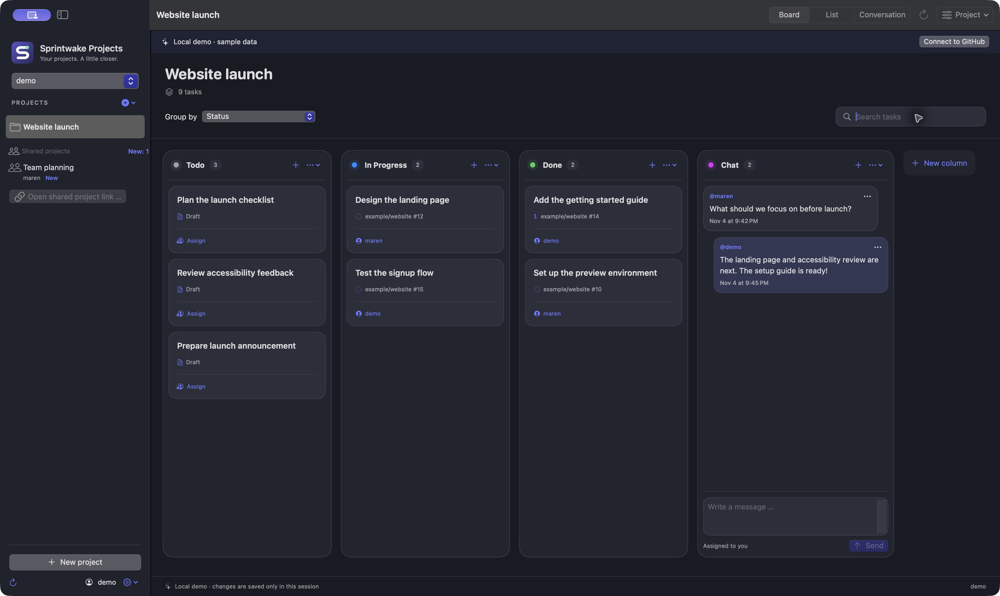
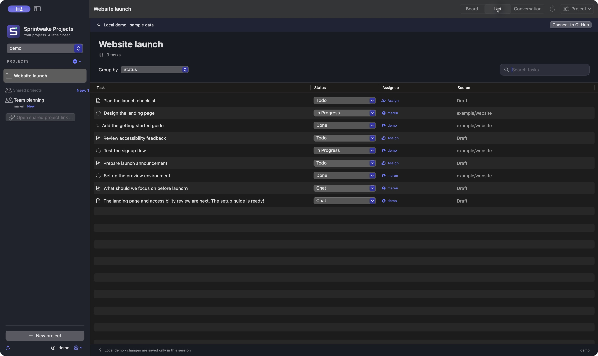
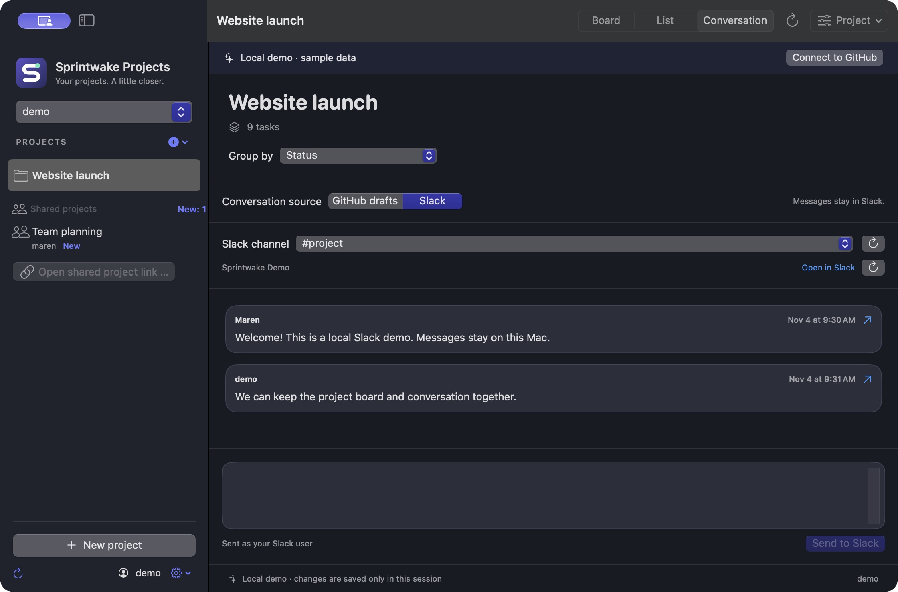

# Sprintwake Projects

English · [Norsk (bokmål)](README.nb.md)

A native macOS client for GitHub Projects. Keep your boards, issues, pull requests,
drafts and project conversations close to your work. Built with Swift 6 and
SwiftUI for macOS 14+, with no backend. Sparkle handles signed app updates.
GitHub remains the source of truth.

**Built-in project chat. No server to run.** Keep tasks and team conversations
together: chat messages are stored as drafts in your GitHub project, and the app
connects directly to GitHub. You do not need to deploy a Sprintwake server or
database. Everyone with project access can read the conversation; sending needs
write access. Slack is an optional extra if your team already uses it.



*Real app screenshots, using an isolated fictional workspace. No personal
projects, accounts or Slack messages are shown.*

## Install

**[Download Sprintwake Projects 0.2.1](https://github.com/oddmundleikvoll/sprintwake-projects/releases/download/v0.2.1/Sprintwake-Projects-0.2.1.zip)**
— **macOS 14+ · Apple Silicon (arm64)**.
[All releases and checksums](https://github.com/oddmundleikvoll/sprintwake-projects/releases)
· [Build from source](#build-from-source). Intel/universal packages have not been qualified.

Install the app:

1. Download the `Sprintwake-Projects-<version>.zip` app archive from Releases.
2. Unzip it and drag **Sprintwake Projects.app** into **Applications**.
3. Open the app. Community builds are ad hoc signed and are not Apple notarized.
   If macOS blocks first launch, review [Apple's first-launch instructions](https://support.apple.com/en-us/102445)
   and use **System Settings → Privacy & Security → Open Anyway** only if you trust
   the download. Keep macOS security protections enabled.
4. Choose **Sign in with GitHub**, open the device verification page and approve
   the displayed code yourself. GitHub currently calls the OAuth app **Fjord Projects**.
5. Select a project. To add Slack, follow the [connection guide](Documentation/Installation.md#connect-slack-optional).
   **The bundled Slack client is currently workspace-limited.** Other workspaces
   can use their own public Slack Client ID and the included manifest.

New installations start in **English**. Norwegian Bokmål and System language are
available in Settings. Saved language choices are preserved.

### Build from source

Install Git, Swift 6 and the macOS SDK through Xcode or Xcode Command Line Tools,
then run on your Mac:

```sh
git clone https://github.com/oddmundleikvoll/sprintwake-projects.git
cd sprintwake-projects
./scripts/test.sh
./scripts/build-app.sh
open "dist/Sprintwake Projects.app"
```

Drag the built app from `dist` into Applications if you want to keep it installed.
Packaging builds for your Mac's architecture. Local builds have public update
checks disabled. Use `./scripts/build-app.sh --debug` for a debug app.
[Release and update setup](Documentation/Updates.md) covers signed release builds.

Try the local demo without signing in or connecting to GitHub or Slack:

```sh
open "dist/Sprintwake Projects.app" --args --demo
```

You can also choose the local demo from the sign-in screen. Demo changes are not saved.

### Ask an LLM to help with setup

Copy this prompt into your assistant. It can guide installation and account setup;
you approve GitHub and Slack authorization in their own sign-in windows.

<details>
<summary>Copy the installation and connection prompt</summary>

```text
Help me install Sprintwake Projects on my Mac and connect it to GitHub and,
optionally, Slack. Use the current README and Documentation/Installation.md at
https://github.com/oddmundleikvoll/sprintwake-projects as the source of truth.

Check my macOS version and processor first. Prefer a compatible published release;
if none exists, guide me through installing Swift 6/macOS SDK and running:
git clone https://github.com/oddmundleikvoll/sprintwake-projects.git
cd sprintwake-projects
./scripts/test.sh
./scripts/build-app.sh
open "dist/Sprintwake Projects.app"
Avoid overwriting a running or existing installation without checking with me.
Explain the community build's first-launch approval using Apple's documented
Privacy & Security flow. Keep Gatekeeper and quarantine protections enabled.

Guide me through Sign in with GitHub and Device Flow. The OAuth registration
currently appears as Fjord Projects. Let me approve the device code myself.
Explain the additional repo scope before I choose private-repository access.
Help me select my project or open its GitHub Projects URL.

For Slack, first read Documentation/Slack-setup.md. The bundled client is currently
workspace-limited. Help me create my own Slack app from
Configuration/SlackManifest.json if needed, with PKCE, token rotation and redirect
sprintwake-slack://oauth/callback. Enter only its public Client ID in Slack app
setup. Guide me through Connect Slack and selecting a channel for this project.
Let me approve scopes myself; workspace administrators may need to approve.

Never ask me to paste access tokens, refresh tokens, client secrets, device codes
or Keychain passwords into this chat or files. Do not send messages or create,
edit or delete real tasks as a setup test. Verify the connection by reading the
board/channel, and tell me exactly what remains unverified. English is the default;
help me choose Norwegian or System language in Settings only if I request it.
```

</details>

See the [step-by-step installation and connection guide](Documentation/Installation.md)
for troubleshooting and setup without an assistant.

## Screenshots

The same fictional **Website launch** project in list view:



Optional Slack conversations, shown with local demo messages:



## Project status

Version 0.2.1/build 3 includes GitHub boards, issues, drafts and project
conversations, optional Slack, and signed Sparkle updates. It fixes issue/PR
assignment failures with `Field 'id' doesn't exist on type 'Assignable'`.
Source and the signed community release are public; macOS CI and public
download/signature checks pass.
Fresh installation on another Mac and a subsequent public update remain unverified.
See [CHANGELOG.md](CHANGELOG.md), [current status](STATUS.md) and
the [ordered publication plan](PLAN.md) for verified scope and remaining work.

The S-shaped trail represents work moving forward. Editable SVG logos and PNG app
icons are in [Branding](Branding/).

## Languages

English is the default on a new installation. Choose **System language**,
**English** or **Norsk (bokmål)** on the sign-in screen or in the app's settings. The choice is saved and the interface updates immediately.
Unsupported system languages fall back to English. GitHub project names, columns,
issue titles and other user content keep their original language.

Translations are standard `.strings` resources in
`Sources/FjordCore/Resources/en.lproj` and `nb.lproj`. `Interface.strings` covers
views; `Core.strings` covers app messages and model labels. Keep both language
tables in sync, including format placeholders, and run `./scripts/test.sh` after
changing them. The app package includes the SwiftPM localization bundle.

## App updates

Official releases check for updates through a signed Sparkle feed hosted with
the GitHub release. A new version shows a download button in the sidebar and
on the sign-in screen. **Sprintwake Projects → Check for Updates …** and the
Updates section in Settings are also available. You choose when to install and
restart. Active writes and unfinished text are protected during an update.

Ordinary local builds and demos do not check public update servers. The first
public build must be prepared using the release process; opening the repository
alone does not enable updates in old locally installed builds.
See [Release and update setup](Documentation/Updates.md). Sparkle 2.10.1 is pinned
in `Package.resolved`; its complete license is included in packaged apps.

## Connect to GitHub

The current public OAuth Client ID is bundled from `Configuration/GitHub.json`.
Choose **Sign in with GitHub**, open github.com/login/device and approve the code.
The existing GitHub registration is still named **Fjord Projects**, owned by
`oddmundleikvoll`; GitHub displays that name during authorization. A public Client
ID does not grant access to an account.

For your own fork, register an OAuth app in
[GitHub developer settings](https://github.com/settings/developers), enable
**Device Flow**, and enter its public Client ID in GitHub setup. A valid homepage
and `http://127.0.0.1` callback can be used; Device Flow does not use the callback.
**Never put a Client Secret in the app or repository.** Override the bundled ID:

```sh
FJORD_GITHUB_CLIENT_ID=your_public_client_id ./scripts/build-app.sh
```

OAuth requests `read:user read:org project public_repo`. Selecting private issues
and pull requests requests `repo` instead of `public_repo`. GitHub's `repo` scope
also grants access to private source code; OAuth provides no narrower scope for
private issues. Organizations may require separate approval or SSO. The private
repository choice is remembered for the next sign-in.

A personal access token is also supported through a secure field. A classic token
needs `project` for project changes, `read:org` for organizations and `repo` for
private issues and pull requests.

If GitHub hides item content, the app explains how many items are inaccessible and
provides **Grant access …**. This starts a new Device Flow with explicit repository
authorization using the same GitHub account. Cancellation or failure preserves
the working session. A verified replacement refreshes the selected project.
Repository membership, organization policy or SSO can still prevent access.
The same flow is available from the account menu.

Credentials, refresh tokens and expiry are stored together in macOS Keychain,
never in defaults or files. Sessions are restored at launch and renewed before
expiry. Network failures and 403 responses preserve the session; 401 invalidates
it. Sign out deletes the local Keychain entry. GitHub can revoke authorization.
Locally rebuilt ad hoc apps can trigger a macOS Keychain access prompt; enter
passwords only in the system dialog.

## Working with projects

- Browse personal and organization projects, open shared project URLs, and create
  projects. Deleting a project requires typing its exact name. Repository issues
  and pull requests survive project deletion.
- **Shared projects** in the sidebar automatically finds accessible boards through
  your organizations, repository collaborators and previously opened project links.
  Entries show their owner and a **New** marker until opened. Opened shared boards
  and their selection are remembered per GitHub account and verified again at launch.
- Switch between board and list, search by title, repository or assignee, and group
  by the project's real single-select fields. Drag cards or use status menus.
  Items without a status stay visible; empty unassigned groups are hidden.
- Create an issue or draft using a column's plus button with placement preset.
  Choose a repository and assignees; look up additional repositories by owner/name.
  ⌘N also opens task creation; the top toolbar has no separate New task button.
- Assign users from a card, row or editor. Issues and pull requests use atomic
  add/remove operations. Drafts require replacing the full assignee list: the app
  reads current values first, but simultaneous edits to the same draft can still
  overwrite each other. The picker explains this limitation.
- Edit drafts, issues and pull requests when GitHub grants write access. The app
  checks for intervening content changes before saving.
- Create and delete real board columns on GitHub, then refresh the app. GitHub's
  API replaces the entire option list without conditional updates, which can
  remove another administrator's concurrent changes. Only the local demo edits
  columns directly in memory.
- Grant an individual reader, writer or administrator project access. Complete
  participant lists, teams and removal use GitHub's **Manage access** page because
  the public ProjectV2 API has no complete collaborator query.
- Refresh manually with ⌘R, when the window activates, or every 30 seconds while
  active. Projects, fields, items and field values are fully paginated.

Shared discovery runs at sign-in, on activation when due, and every minute while
active, without changing the selected board. Repository-owner connections are
cached for up to ten minutes; **⌘R** or sidebar refresh checks them immediately.
Large accounts rotate through up to 20 project owners per round, keeping prior
entries visible while the remaining owners are checked. GitHub rate limits pause
discovery until its retry/reset time; refreshing manually respects that pause.
Temporary failures keep the prior affected entries and display an explanation.
Successful reads remove projects whose access has disappeared.

GitHub has no documented global list of every Projects board shared with a user.
For a standalone project from an entirely unknown owner, open its project link
once; the app then checks that owner's projects automatically. Personal public
read-only boards also need a link once: public visibility alone does not prove a
direct share. Private accessible boards, editable public boards and boards in
your organizations are discovered through the connections above. Repository
membership only supplies candidates; GitHub must separately return project access.
The Projects API grants collaborator roles but has no documented pending-invitation
inbox or accept/decline operations. See [discovery coverage](PLAN.md).

Issue creation, project linking and column placement are separate GitHub writes.
A confirmed create stays successful if a later step fails. The app preserves the
created issue URL and explains what remains, preventing duplicate creation retries.

## Project conversations

Project chat is built in and works with your GitHub connection alone. There is
no separate chat account, Slack requirement or server for you to host. GitHub
stores the messages in the project and controls access through project permissions.

Use the conversation column on the board or the larger conversation view. A column
named `Chat` or `Samtale` is selected automatically. Another column can be chosen
through its menu; the choice is saved per project and grouping field.

Each message is a project `DraftIssue`, assigned to the signed-in user. The body
contains the full message, the title a preview, and GitHub's creator/timestamp
provide authorship. Other drafts in that column also appear as messages. These
items remain visible on GitHub's board and count as project tasks.

Your own message appears as soon as GitHub confirms creation and column placement,
without waiting for a full project refresh. The send response provides its real
item ID, creator and timestamp. Other participants' messages still arrive by polling.

Anyone who can read the project can read the conversation. Delivery uses polling;
there are no typing indicators, read receipts or separate message permissions.
If creation succeeds but placement cannot be confirmed, inspect the conversation
and unassigned drafts before retrying. A lost HTTP response can follow a successful
placement; the app does not resend the message.

## Optional Slack conversations

Projects can use a Slack channel instead of GitHub drafts. Open **Project → Slack
channel …**, connect Slack, and choose a channel. The bundled client is currently
workspace-limited; users in other workspaces can register their own client using
the included manifest and enter its public Client ID in Settings without rebuilding.
An existing Slack browser session may be reused during consent, but
Slack still asks the user to approve access. Credentials are stored in Keychain
per GitHub account and project/channel bindings remain local. The app reads and
sends plain text, polls while active, opens threads and files in Slack, and keeps
ambiguous sends for review instead of retrying automatically. See
[Slack setup](Documentation/Slack-setup.md).
Confirmed Slack sends appear immediately, and an older in-flight history request
cannot remove them.

## Development and verification

`Sources/FjordCore` contains transport, authentication, session storage and app
state. `Sources/Fjord` contains SwiftUI views. The original Swift targets,
`no.oddmund.Fjord` bundle identifier, Keychain service and `FJORD_*` build variables
are retained to preserve installed sessions and preferences across the rename.

`./scripts/test.sh` runs isolated tests with injected transports and in-memory
storage. They use no real credentials, network requests or GitHub writes. The
script handles the bundled TestingMacros discovery issue in Swift 6.4 CLT.
Optional isolated Keychain round-trip with cleanup:

```sh
FJORD_KEYCHAIN_TEST=1 ./scripts/test.sh --filter KeychainTests
```

CI runs tests and app packaging on macOS. No separate linter or formatter is
configured. [AGENTS.md](AGENTS.md) records working conventions;
[CONTEXT.md](CONTEXT.md) describes architecture; [STATUS.md](STATUS.md) records
verification and known limits.

Roadmap views, workflows, other custom field types, widgets, notifications and
offline editing are not implemented. Preparing a community release requires a
clean committed tree and the Sparkle signing key. The optional `--notarize` path
also requires Apple Developer membership, a Developer ID certificate and a
notarization profile.

API contracts: [Projects](https://docs.github.com/en/graphql/reference/projects),
[Issues](https://docs.github.com/en/graphql/reference/issues),
[Device Flow](https://docs.github.com/en/apps/oauth-apps/building-oauth-apps/authorizing-oauth-apps),
[Keychain](https://developer.apple.com/documentation/security/keychain-services).

## License

Sprintwake Projects is available under the [MIT License](LICENSE), also included
in the packaged app as `Sprintwake-LICENSE`.
Sparkle is distributed under its own license, included in the packaged app as
`Sparkle-LICENSE`. GitHub and Slack are separate services with their own terms.
