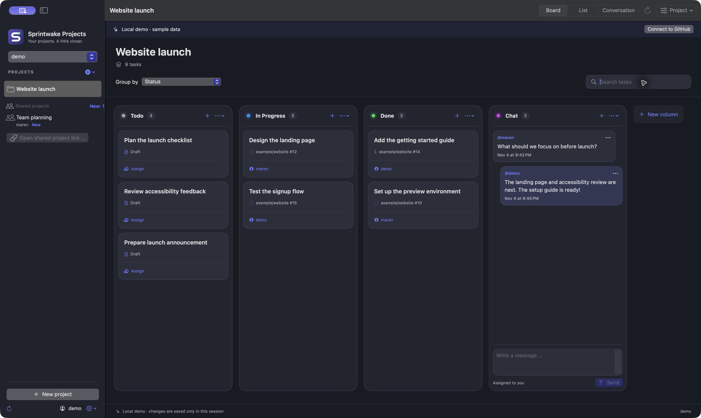

# Sprintwake Projects

[English](README.md) · Norsk (bokmål)

En liten SwiftUI-app for GitHub Projects på macOS 14 eller nyere. Ingen ekstern
backend. Sparkle håndterer signerte appoppdateringer. GitHub er kilden til prosjektdataene.
Navnet **Sprintwake Projects** binder sammen fremdrift og arbeidsflyt. S-logoen er et sammenhengende spor med en mintgrønn endestasjon.
Redigerbar logo og PNG-er ligger i `Branding/`.



*Skjermbildene viser appen med isolerte eksempeldata, uten private prosjekter,
kontoer eller ekte Slack-meldinger.*

## Installer

Krever **macOS 14 eller nyere**. Første nedlastbare utgivelse klargjøres;
inntil videre kan du [bygge fra kildekoden](#bygg-og-start). Ferdige pakker vil
ligge på [GitHub Releases](https://github.com/oddmundleikvoll/sprintwake-projects/releases).
Den første pakken er for **Apple Silicon (arm64)**. Intel/universal er ikke kvalifisert.

Når pakken er tilgjengelig: last ned appens ZIP, pakk ut og dra
**Sprintwake Projects.app** til **Programmer**. Fellesskapsutgaven er ad hoc-signert
og ikke Apple-notarisert. Ved blokkert første oppstart, se
[Apples veiledning](https://support.apple.com/en-us/102445) og bruk
**Systeminnstillinger → Personvern og sikkerhet → Åpne likevel** bare hvis du stoler
på nedlastingen. Behold sikkerhetsbeskyttelsen i macOS aktivert.

Velg **Sign in with GitHub** og godkjenn Device Flow i nettleseren selv.
GitHub viser fortsatt registreringsnavnet **Fjord Projects**.
Slack er valgfritt; den medfølgende Slack-registreringen er foreløpig begrenset
til utviklerens arbeidsområde. Andre arbeidsområder kan bruke en egen offentlig
Client ID og manifestet i repoet. Se [installasjon og tilkobling](Documentation/Installation.md).

**Engelsk er standardspråket ved første oppstart.** Velg norsk bokmål eller
systemspråk i Innstillinger. Eksisterende språkvalg beholdes.

[Engelsk README](README.md#ask-an-llm-to-help-with-setup) har en kopierbar
LLM-prompt for installasjon og oppsett av GitHub/Slack, samt flere skjermbilder.

## Prosjektstatus

Versjon 0.2.0/build 2 er implementert og verifisert lokalt, inkludert valgfri Slack
og signerte Sparkle-oppdateringer. Publisering og kontroll av fersk installasjon
pågår. Se [dagens status](STATUS.md) og [prioritert plan](PLAN.md).

## Bygg og start

Du trenger Swift 6 og macOS SDK fra Xcode eller Xcode Command Line Tools.

```sh
git clone https://github.com/oddmundleikvoll/sprintwake-projects.git
cd sprintwake-projects
./scripts/test.sh
./scripts/build-app.sh
open "dist/Sprintwake Projects.app"
```

Appen bygges for Macens egen arkitektur og signeres lokalt med en ad hoc-signatur.
Dette er en lokal utviklingsversjon. Offentlige fellesskapsutgaver bruker egne
signerte Sparkle-oppdateringer og krever ikke betalt Apple-medlemskap. macOS kan
kreve manuell godkjenning ved første installasjon. Developer ID-signering og
notarisering er et valgfritt utgivelsesløp.

For debug: `./scripts/build-app.sh --debug`. For en isolert lokal demo:
`open "dist/Sprintwake Projects.app" --args --demo`, eller velg «Utforsk en lokal demo» i appen.
Demoen endrer ingenting på GitHub og lagres ikke mellom oppstarter.

## GitHub-innlogging

Sprintwake Projects bruker fortsatt OAuth-registreringen **Fjord Projects**, registrert av
`oddmundleikvoll`. Den offentlige Client ID-en ligger i
`Configuration/GitHub.json` og bakes inn i app-pakken. Vanlige brukere kan velge
«Logg inn med GitHub» direkte. Client ID-en gir i seg selv ingen kontotilgang.

Ved en egen fork kan utvikleren registrere én OAuth-app på
[GitHub → Developer settings → OAuth Apps](https://github.com/settings/developers).
Dette er ikke nødvendig for hver bruker av den ferdig konfigurerte appen.

1. Registrer appen med navnet `Fjord Projects`, en gyldig hjemmeside og callback
   `http://127.0.0.1`. Callbacken brukes ikke av Device Flow.
2. Åpne registreringen og aktiver **Enable Device Flow**.
3. Legg den offentlige **Client ID** inn under «GitHub-oppsett» i Sprintwake Projects.
   **Client Secret skal aldri legges inn i appen eller kildekoden.**
4. Velg «Logg inn med GitHub», åpne github.com/login/device og godkjenn koden.

Client ID fra konfigurasjonsfilen kan overstyres ved bygging:

```sh
FJORD_GITHUB_CLIENT_ID=din_offentlige_client_id ./scripts/build-app.sh
```

Som lokal alternativ innlogging kan du legge inn en personlig GitHub-token i
appens sikre tokenfelt. En klassisk token trenger `project` for prosjektendringer,
`read:org` for organisasjonslisten og `repo` for private issues/PR-er. OAuth ber om
`read:user read:org project public_repo`, eller `repo` i stedet for `public_repo`
når brukeren velger private repositories. OAuth-scope `repo` gir også tilgang til
privat kildekode; GitHub tilbyr ikke et smalere OAuth-scope for private issues.
Organisasjoner kan kreve egen godkjenning/SSO.

Hvis kort vises som «Privat eller utilgjengelig oppgave», har GitHub skjult selve
issue-/PR-innholdet for innloggingen. Prosjekttilgang alene er ikke nok for private
repositories. Appen viser antall skjulte kort og **Gi tilgang …**. Velg dette,
les forklaringen om `repo`, og fullfør Device Flow med samme GitHub-konto.
Den gamle økten beholdes ved avbrudd eller feil; den nye nøkkelen tas i bruk etter
bekreftet innlogging, og det valgte prosjektet oppdateres. Du finner også flyten
under tannhjulet → **Tilgang til private oppgaver …**. Valget om private repositories
huskes til neste innlogging. GitHub kan fortsatt skjule kort ved manglende
repository- eller organisasjonstilgang/SSO.

Navnebyttet beholder bundle-ID `no.oddmund.Fjord`, nøkkelringtjenesten og eksisterende
innstillinger. Swift-modulene og miljøvariablene beholder også navn med `Fjord`/`FJORD`.
GitHub viser derfor fortsatt «Fjord Projects» under godkjenningen.

Tilgangsnøkkel, eventuell refresh-token og utløp lagres samlet i macOS Keychain,
aldri i UserDefaults eller filer. Gyldig innlogging gjenbrukes ved oppstart.
Utløpende Device Flow-tokens fornyes før utløp. Nettverksfeil og 403 beholder
innloggingen; 401 fjerner den og ber om ny innlogging. «Logg ut» sletter den lokale
nøkkelringoppføringen. Du kan også tilbakekalle appens tilgang på GitHub.
Når en lokalt ad hoc-signert utviklingsapp bygges på nytt, kan macOS be om
nøkkelringtilgang igjen fordi signaturen er endret. Passord skrives bare i macOS-dialogen.

## Prosjektarbeid

- Velg personlige prosjekter eller organisasjoner, eller åpne en delt prosjektlenke.
  Opprett nye prosjekter fra sidepanelet. «Prosjekt → Slett prosjekt» krever at du
  skriver prosjektnavnet; slettingen er permanent. Repository-issues og PR-er beholdes.
- Tavle og liste har tydelige visningsknapper, søk i tittel/repository/ansvarlig,
  faktiske enkeltvalgsfelt, og hurtigvalg for status og tildeling.
- «+» i en kolonne åpner ny issue med kolonnen forhåndsvalgt. Velg repository,
  tittel, beskrivelse og ansvarlige. Du kan også velge et prosjektutkast.
  ⌘N åpner også oppgavevinduet. Den separate knappen øverst til høyre er fjernet.
  Repositorylisten hentes fra prosjektet og eksisterende oppgaver; andre kan
  finnes med oppslag på `eier/repository`.
- Klikk «Tildel» eller navnet på et kort, i listen eller i oppgavevinduet.
  Forslag hentes fra prosjektets repositories; et annet GitHub-brukernavn kan
  søkes opp. GitHub avgjør hvem som kan tildeles og om du har skrivetilgang.
  Issues/PR-er bruker separate legg til/fjern-operasjoner. Utkast krever hele
  tildelingslisten: appen leser ferske verdier først, men samtidige endringer på
  samme utkast kan fortsatt overskrive hverandre. Dette vises også i tildelingsvinduet.
- Dra kort mellom kolonner eller velg status fra listen/oppgavevinduet.
  En tom «uten status»-gruppe vises ikke. «Mangler status» vises bare når faktiske
  oppgaver mangler en verdi; oppgavene beholdes og kan flyttes til en kolonne.
- Rediger tittel/beskrivelse på utkast, issues og PR-er når GitHub gir skrivetilgang.
  Samtidige innholdsendringer oppdages før lagring.
- Kolonnemenyene og «Prosjekt → Kolonner» viser statusvalg og antall oppgaver.
  **På ekte prosjekter fullføres legg til/slett på GitHub**, deretter oppdateres
  Sprintwake Projects. GitHubs API erstatter hele valglisten uten versjonskontroll; appen gjør
  ikke dette, siden det kan fjerne andres samtidige kolonneendringer. Den lokale
  demoen støtter direkte legg til/slett, inkludert å beholde oppgaver uten status.
- **Delte prosjekter** i sidepanelet finner tilgjengelige tavler gjennom
  organisasjonene dine, repository-samarbeidspartnere og tidligere åpnede
  prosjektlenker. Eier og **Ny**-merking vises tydelig. Åpnede delte prosjekter
  og prosjektvalget huskes per GitHub-konto og kontrolleres igjen ved oppstart.
- «Prosjekt → Deltakere og tilgang» gir en GitHub-bruker leser-, skrive- eller
  administratortilgang. Dette krever prosjektadministratortilgang. Full deltakerliste,
  team og fjerning av tilgang åpnes i GitHubs **Manage access**; den offentlige
  ProjectV2-API-en har ingen dokumentert komplett lesespørring for deltakere/roller.
- Oppdater med ⌘R, ved aktivering av vinduet, eller hvert 30. sekund mens appen er
  aktiv. Prosjekter, felt, oppgaver og feltverdier pagineres helt.
- En bekreftet oppretting regnes som lagret selv om etterfølgende prosjektkobling,
  kolonneplassering eller oppdatering feiler. Appen forklarer hva som mangler og
  beholder lenken til en opprettet issue, slik at du unngår å opprette den på nytt.

Roadmap, innstillinger for GitHub-visninger, workflows, egendefinerte felt av andre
typer, macOS-widgets, varsler og offline-redigering er foreløpig ikke implementert.

Delte prosjekter sjekkes ved innlogging, ved aktivering når det er tid for ny sjekk,
og hvert minutt mens appen er aktiv. Repository-tilknytninger mellom eiere
mellomlagres i opptil ti minutter; **⌘R** eller sidepanelets oppdatering sjekker dem
med en gang. Henting endrer ikke valgt tavle. Midlertidige feil beholder tidligere
berørte oppføringer og vises i sidepanelet. Bekreftet bortfalt tilgang fjerner
prosjektet fra listen.
Store kontoer sjekker opptil 20 prosjekteiere per runde. Tidligere oppføringer
beholdes mens resten sjekkes. Ved ratebegrensning venter appen til GitHub tillater
nye forsøk; manuell oppdatering respekterer også denne pausen.

GitHub har ingen dokumentert global liste over alle tavler som er delt med deg.
For et frittstående prosjekt fra en helt ukjent eier må du åpne prosjektlenken
én gang; deretter sjekkes denne eierens prosjekter automatisk. Personlige,
offentlige tavler med bare lesetilgang må også åpnes via lenke én gang, fordi
offentlig synlighet alene ikke beviser en direkte deling. Tilgjengelige private
tavler, offentlige tavler med skrivetilgang og organisasjonenes tavler finnes
gjennom tilknytningene over. Prosjekttilgang sjekkes separat fra repository-tilgang.
ProjectV2-API-et tildeler roller, men dokumenterer ingen egen innboks eller
godta/avvis-operasjoner for tavleinvitasjoner. Se [PLAN.md](PLAN.md).

## Prosjektsamtale

Skriv direkte i **Samtale-kolonnen på tavlen**, eller velg visningen **Samtale**
for større plass. En kolonne som heter «Samtale» eller «Chat» velges automatisk.
Andre kolonner kan velges via kolonnemenyen «Bruk som samtalekolonne». Valget
huskes per prosjekt og grupperingsfelt. Legg til kolonnen på GitHub ved behov og
oppdater Sprintwake Projects etterpå; den lokale demoen har en samtalekolonne fra starten.

Hver melding blir ett `DraftIssue` i prosjektet. Hele teksten lagres i beskrivelsen,
en kort forhåndsvisning i tittelen, og `assigneeIds` settes til innlogget bruker.
Meldingen plasseres deretter i den valgte kolonnen. Avsenderen vises fra GitHubs
`creator` og tidspunkt fra `createdAt`; endret tildeling omskriver ikke historikken.
Bare utkast i denne kolonnen vises som meldinger. De samme utkastene er synlige i
den vanlige GitHub-tavlen og teller som prosjektoppgaver.

Din egen melding vises straks GitHub bekrefter oppretting og kolonneplassering.
Appen bruker meldingen fra sendesvaret og venter ikke på at hele prosjektet hentes
på nytt. Meldinger fra andre deltakere hentes fortsatt med polling. Slack viser
også bekreftede sendinger direkte; en eldre pågående henting kan ikke fjerne dem.

Alle som kan lese prosjektet kan lese meldingene. Dette er en prosjektchat med
polling, uten skriveindikator, sanntidslevering, lesekvitteringer eller separate
meldingsrettigheter. Utkast som allerede ligger i kolonnen vises også i samtalen.
Hvis meldingen opprettes, men plassering i kolonnen ikke kan bekreftes, vises en
melding om å sjekke både chatten og utkastene uten status. Ved tapt HTTP-svar kan
GitHub allerede ha utført flyttingen. Teksten sendes ikke om igjen.

## Valgfri Slack-samtale

Et prosjekt kan bruke en Slack-kanal i stedet for GitHub-utkast. Velg **Prosjekt →
Slack-kanal …**, koble til Slack og velg en kanal. Eierens offentlige klient-ID
følger med bygget; egne forks kan registrere en klient med manifestet som følger
med. En eksisterende Slack-innlogging i nettleseren kan brukes
under godkjenningen, men Slack ber fortsatt om samtykke. Tilgang lagres i macOS
Keychain per GitHub-konto, mens prosjekt- og kanalvalg lagres lokalt. Appen leser
og sender ren tekst, oppdaterer aktivt prosjekt med polling og åpner tråder/filer
i Slack. Ved usikker levering beholdes teksten for kontroll i stedet for
automatisk ny sending. Se [Slack-oppsett](Documentation/Slack-setup.md).

## Oppdatering av appen

Offisielle utgivelser bruker Sparkle til å finne og verifisere oppdateringer fra
GitHub Releases. En ny versjon viser en nedlastingsknapp i sidepanelet og på
innloggingsskjermen. Du kan også bruke **Sprintwake Projects → Se etter
oppdateringer …** eller Oppdateringer under Innstillinger. Du velger når appen
skal installere og starte på nytt. Pågående lagring og uferdig tekst beskyttes.

Lokale bygg og demoer sjekker ikke den offentlige oppdateringstjenesten. Første
offentlige utgivelse bygges med `./scripts/release.sh`, som signerer oppdateringene
med appens egen nøkkel. Apple-medlemskap er valgfritt; `--notarize` legger til
Developer ID-signering og notarisering. Eldre lokale installasjoner må først
erstattes med den offentlige utgaven. Se [Utgivelse og oppdateringer](Documentation/Updates.md).

## Verifisering og struktur

`./scripts/test.sh` kjører isolerte tester med injisert HTTP-transport og minnelagring.
Skriptet bruker `swift test` og laster den medfølgende TestingMacros-pluginen
eksplisitt ved behov i Swift 6.4 Command Line Tools.
De bruker ikke ekte GitHub-tokens og utfører ingen nettverkskall eller GitHub-skriving.
Valgfri faktisk nøkkelringtest med egen tilfeldig tjeneste og opprydding:

```sh
FJORD_KEYCHAIN_TEST=1 ./scripts/test.sh --filter KeychainTests
```

`Sources/FjordCore` inneholder API, autentisering, lagring og applikasjonstilstand.
`Sources/Fjord` inneholder SwiftUI-grensesnittet. `AGENTS.md` dokumenterer kommandoer
og konvensjoner. `STATUS.md` beskriver hva som er kjørt og hva som gjenstår.

Offisielle API-kontrakter:
[Projects](https://docs.github.com/en/graphql/reference/projects),
[Issues](https://docs.github.com/en/graphql/reference/issues),
[Device Flow](https://docs.github.com/en/apps/oauth-apps/building-oauth-apps/authorizing-oauth-apps),
[Keychain](https://developer.apple.com/documentation/security/keychain-services).


## Utforming

Arbeidsområdet har en samordnet indigopalett som følger lys og mørk visning i
macOS. En tydelig prosjektoverskrift, et roligere sidepanel, fargede kolonnemerker
og fremhevede oppgavekort skiller navigasjon fra arbeid. Søk, hurtigtaster,
tildeling og meldingsfelt fungerer som før.

## Språk

Velg **Systemspråk**, **English** eller **Norsk (bokmål)** på innloggingsskjermen
eller under appens innstillinger. Valget huskes og grensesnittet oppdateres med
en gang. Engelsk brukes når systemspråket ikke støttes. Prosjektdata, kolonnenavn
og oppgavetitler fra GitHub oversettes ikke.

## Lisens

Prosjektet bruker [MIT-lisensen](LICENSE). Sparkles egen lisens følger med appen.
